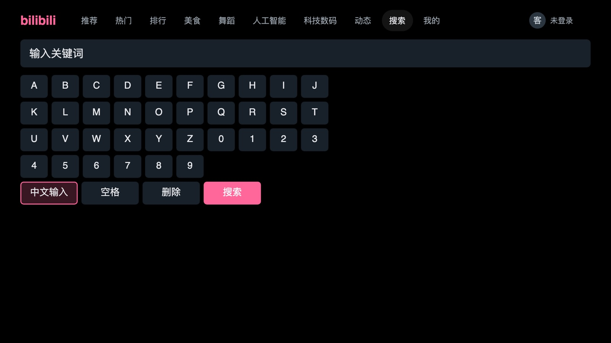

# bilibili on Samsung TV

**[中文](README.md) · English**

A bilibili client for Samsung Tizen televisions, driven entirely by the remote.
The TV talks to bilibili directly: **no backend, no proxy, no server, and your
credentials never leave the set.**

Several people can be signed in at once, each with their own watch history;
what you half-watched on the phone is under the cursor when the TV comes on.

> LG webOS has a good one, [bili-webos](https://github.com/asdf17128/bili-webos).
> The Samsung side was empty. This fills that gap.
>
> **Not affiliated with bilibili or Samsung.** Personal project, MIT.
>
> Sibling projects: [douyin-tizen](https://github.com/titlog/douyin-tizen) (Douyin on Samsung TVs) and
> [telegram-tizen](https://github.com/titlog/telegram-tizen) (the videos in your Telegram groups and channels).

|  |  |
|---|---|
|  |  |
| Three big cards a row, readable from the sofa; signed in, the top row is 「continue watching」 and the cursor starts on it | Danmaku drift right to left without overlapping, and pause and change speed with the video; scrubbing with thumbnail previews; up to 1080p H.265 when signed in, 4K with a 大会员 (premium) account |
|  |  |
| Press down while playing for the panel — **the video keeps running**: danmaku on/off, like, coin, favourite, comments and speed in one row, a follow button by the uploader; parts, the collection (long ones folded into ranges of 50, listed on the right) and related videos. Back from a related video or the uploader's page returns to the video you were watching | Comments and replies beside the video, which keeps playing |
|  |  |
| Settings: autoplay, subtitles, danmaku, quality cap, clearing watch history, self-update, diagnostic logs, and cards per row to suit the TV and the sofa | Search, with the TV's own Chinese IME one button away |
|  |  |
| Live: the streamers you follow who are on come first, then the whole site by popularity; inside, up and down change room like channels | Your own top bar: pick a tab up and move it left or right, take it off with down, add from the row below with one press |

## Will it run on my TV

| | |
|---|---|
| **Verified** | Samsung 2023 65" **CU7090**, firmware Tizen 9.0 (Chromium 120). Every measurement in this project comes from this one set |
| **Community-tested** | Samsung 2020 55" **Q90T**, Tizen 5.5 (Chromium 69), tested by the author of [PR #2](https://github.com/titlog/bilibili-tizen/pull/2) on their branch; the old-engine compatibility comes from there |
| **Community-tested** | Samsung 2018 49" **UA49NU7100**, Tizen 4.0 (Chromium 56). 1.4.0 installed from source works ([#4](https://github.com/titlog/bilibili-tizen/issues/4)) |
| **Community-tested** | Samsung 2018 75" **Q8C**, Tizen 3.0 (Chromium 47). Videos play from 1.3.4, live streams from 1.3.6 ([#5](https://github.com/titlog/bilibili-tizen/issues/5)) |
| **Very likely** | 2020 onwards (Tizen 5.5+). Playback uses standard MSE and AVPlay, nothing model-specific — but **no other model has been tried yet** |
| **Installs, untested** | Other 2017–2019 sets (Tizen 3.0–5.0, Chromium 47–63), allowed to install from 1.2.5. One Tizen 3.0 and one Tizen 4.0 set have been tried (above); Tizen 5.0 has not. **If you install it on one, please open an issue saying how it went** |
| **No** | Non-Samsung sets; Samsung models from 2016 and earlier (Tizen 2.x) |

A build from source reports its engine string and codec support on boot; that
line is the first thing to read (the release package reports nothing). **Either
way, if it works or fails on another model, please open an issue with the model
and firmware version** — that is how this table grows.

## Install

Samsung's store does not accept third-party clients for other people's services
(it pulled the unofficial Twitch app in 2019 for exactly that), so this is
sideloaded — **once**; after that the app opens from the TV like any other, and
installs new versions itself (from 1.2.0 on). Two ways:

| | Release package (recommended) | From source |
|---|---|---|
| For | Watching bilibili on the TV | Changing the code, reading diagnostics |
| Needs | A computer (Windows / macOS / Linux) **or an Android phone** with [Apps2Samsung](https://github.com/Apps2Samsung/Apps2Samsung) | macOS, Node 22.13+, Python 3, Tizen Studio CLI |
| Upgrade | Automatic from 1.2.0 on; older versions: install again with Apps2Samsung | Automatic from 1.2.0 on too; or `git pull`, run `deploy.sh` again |

**From 1.2.0 on, the app updates itself**: a minute after every launch, when
nothing is playing, it checks for a new version, then every 6 hours while open; it downloads a
newer version, verifies its signature and runs it from the next launch; a version
that fails to start falls back to the one installed.

- **"The next launch" means really quitting and reopening it**: press Back on the
  推荐 (recommended) page to quit the app, then open it again from the TV's home
  screen. Pressing Home to switch to another app, or turning the TV off and on,
  usually just suspends the app, and it comes back on the same version.
- The 设置 (settings) tab can switch self-update off and check now; the line
  below says which version is installed, which is running and which is
  downloaded.
- Built from source and changed the code? Switch self-update off in 设置, or the
  next higher version in this repository replaces your code on the next launch.
- Versions before 1.2.0 (and going back to an older version) upgrade by hand.

**Both ways start here:** enable Developer Mode on the TV — on the Apps screen,
type `12345` with the remote, switch it on, and set Host PC IP to the computer or
phone you will install from — then **power-cycle the set completely**. Without
that the registration does not take, and the symptom is the TV not being found,
or connections timing out silently.

Both ways also need a Samsung account (free to create): the first install asks
you to sign in, to get this TV a certificate, and that is all.

### Release package

1. Install [Apps2Samsung](https://github.com/Apps2Samsung/Apps2Samsung/releases),
   desktop or Android.
2. Open it and select your TV (enter its IP if it is not listed).
3. Find **bilibili** in its app list (the community catalog) and install it. The
   first time, it asks you to sign in to Samsung and issues the certificate for
   this TV.

The community catalog picks up the latest release from here once a day. For a
version it has not picked up yet, or a specific one, download
`bilibili-tizen-<version>.wgt` from
[Releases](https://github.com/titlog/bilibili-tizen/releases/latest) and choose a
custom `.wgt` in step 3 instead.

The package is re-signed with your own certificate on install, so the same file
works for everyone.

**Only an iPhone?** Apps2Samsung has no iOS version; sideloading takes a computer
or an Android phone. It is needed once (after that the TV installs new versions
itself), so borrowing a computer for the install is enough.

### From source

You need Node 22.13 or newer (`node --version`), Python 3, and the
[Tizen Studio](https://developer.tizen.org/development/tizen-studio/download)
command-line tools (**not the IDE**). Samsung sets from 2023 on only accept
Samsung-issued distributor certificates — the ones that ship with Tizen Studio
all fail with `Invalid certificate chain` — and the certificate is bound to the
TV's DUID. `setup.sh` opens the Samsung account login, requests that certificate
for you, and needs no Eclipse, no sudo, no certificate-manager GUI.

```bash
git clone https://github.com/titlog/bilibili-tizen.git && cd bilibili-tizen
zsh tools/setup.sh      # once: installs the packages, finds the TV, reads its DUID, issues the certificate; config lives outside the repo
zsh tools/deploy.sh     # check, sign, install, launch — about 15 seconds
```

> **Do not switch between the two.** They sign with different certificates, and
> the TV will not let a package signed with one replace the same app signed with
> the other. To switch, delete the app on the TV first, then install — that wipes
> the QR sign-ins and local watch history, so accounts need scanning again;
> progress already reported to the bilibili account is kept.

> Only need the certificate, for something unrelated? It is a standalone tool:
> **[samsung-tv-cert](https://github.com/titlog/samsung-tv-cert)**
> [](https://www.npmjs.com/package/samsung-tv-cert)
> — `npx samsung-tv-cert --duid <your DUID>`. Useful for Jellyfin, community
> Twitch, or anything else you sideload onto a Samsung set.

## Accounts and privacy

- QR sign-in, any number of accounts, switching needs no rescan.
- **Credentials are stored only in the TV's local storage.** No analytics, no
  ads, no third-party SDK. Stream URLs are pre-signed, so media requests carry
  no account.
- Watch progress is reported back to bilibili (every 30 s), so the phone and the
  web can pick up where the TV left off — and vice versa.
- Like, coin and favourite write to your bilibili account, and only when you pick
  them on the TV; a coin cannot be taken back, so you pick how many first.
- The default sign-in is the **TV login** route, signed with the official TV
  client's appkey. That is what makes multiple accounts and progress reporting
  possible; it also means your client presents itself to bilibili as the official
  TV client. That is a terms-of-service judgement, not a technical one; the web
  QR route is there if you would rather not, at the cost of one account and no
  progress reporting. The full trade-off is in [`docs/登录路径.md`](docs/登录路径.md) (Chinese).
- An expired token means scanning again (the refresh endpoint has not been
  verified against the server, and guessing on the one path that holds the whole
  household's credentials is not something this project does).
- **Diagnostic logs (from 1.3.2)**: when something goes wrong, the app sends the
  developer the information needed to find out why, and nothing that identifies
  you. It can be switched off in 设置 (settings); when reporting a problem, quote
  the TV's code shown there.
- Builds installed from source send diagnostic logs the same way as the release
  package (from 1.4.1), and can be switched off in 设置; or put `BILI_DIAG_TO=off`
  in `~/.bilibili-tizen.conf` and the builds you install send none.

## What it does, and what it deliberately does not

**Does**: recommendations / live / popular / rankings / zones / dynamic feed /
watch-later / search with the TV's own Chinese IME, multi-part uploads, resume
(remembers which part, picks up from the phone), autoplay next, scrub previews,
parts and related videos over a running video, uploader pages (press the
uploader's name in the panel, or 右 on the end-of-video screen, for everything
they have posted; 返回 goes back to the tab you came from). About **2.5–3.5 s**
from OK to a picture, 1080p H.265.

**Live** (直播 in the top bar): the streamers you follow who are live come first,
then everything live on the site by popularity; inside a room, up and down change
room the way a TV changes channel. Signed out it is 720p, and there are no live
danmaku yet. **Your own top bar**: in 设置, add or remove 直播, 动态, 我的, 稍后, 热门, 排行
and any of the 30 zones, and put them in your own order (推荐 stays first, 搜索
and 设置 last); the bar slides sideways with the focus when it does not fit. Multi-part
uploads list their parts in one sliding row in the playback panel.

Also: danmaku (off / sparse / standard / dense, in 设置; on/off in the panel);
collections (合集 — tiled in the panel, folded into ranges of 50 past that with
the range listed on the right, and the next episode plays when one ends);
following uploaders (in the panel and on their page); a quality cap (highest by default: 4K for 大会员 accounts) and
clearing this set's watch history; favourite folders and followed uploaders under 「我的」; comments (with
replies) beside the running video; subtitles; like, coin and favourite (three
buttons in the playback panel, as on the web page — 投币 asks how many coins in
the row below and likes too; holding OK on a card still works); and a
「设置」 tab — autoplay next, subtitles on/off, and cards per row (3 / 4 / 5, to
suit how big the TV is and how far the sofa). These come from
[PR #2](https://github.com/titlog/bilibili-tizen/pull/2).

Press Down during playback to turn subtitles on or off, select a track, or return to automatic selection. The language preference persists across videos and app restarts. Human subtitles take priority within the same language; unavailable languages fall back without replacing the preference. Press Back once to collapse the choices and again to close the panel.

**Does not**:
- **Casting from the phone.** A cast receiver has to listen on a port; a Tizen
  web widget cannot, regardless of how official it is. The substitute is
  watch-later: tap on the phone, open on the TV.
- **Liking or posting comments.** The TV's direct calls to the comment write endpoints are refused (403); comments are read-only.

## FAQ

**The TV is not found, or `sdb` cannot reach it.** Is the IP registered in
Developer Mode the *current* IP of the computer (or phone) you install from, and
did you power-cycle the set after changing it? A DHCP change means re-registering.

**`Invalid certificate chain` (from source).** You are using a Tizen-bundled
certificate. Run `zsh tools/setup.sh` for a Samsung-issued one.

**You already made a signing profile in Tizen Studio's Certificate Manager.** No
need to edit the scripts: put `BILI_PROFILE="<profile name>"` in
`~/.bilibili-tizen.conf` and `deploy.sh` signs with it instead of the
certificates `setup.sh` issues.

**The install says the TV already has this app signed with a different
certificate.** It was installed the other way; see "Do not switch between the
two" above.

**A video will not open: 「视频流被拒绝（403）」.** Usually CDN throttling or a
per-file refusal. The app rotates mirrors, escalates the token, switches codec
family and drops tiers on its own; the message means all of that was tried. Wait
a few minutes or pick another video.

**The dynamic feed / watch-later tab is empty.** Both need a signed-in account;
scan from 「我的」 first.

**A code change has no effect.** Check the boot line the TV reports; `deploy.sh`
derives the package name from `config.xml`, so after renaming the app make sure
it is pushing the new package.

## For developers: what this platform actually allows

The client is the result; the time went into finding out what the platform can
do. Each of these cost at least a day and none of them is written down elsewhere:

- **bilibili needs no `Referer`, but rejects by UA.** Probing with bare `curl`
  makes every response read like "Referer required" — a false signal that nearly
  put a proxy into this project that it never needed.
- **This firmware's widget cannot send a `Cookie` header.** Chromium 120 silently
  drops forbidden headers, so signed-in sessions ride in the query as
  `access_key`. The earlier "it can" conclusion was measured with one account on
  the set, where the measurement had no power to distinguish anything.
- **The same upload plays on the phone and not on the TV because of playurl's
  `platform`.** Tokens minted by the web endpoint get 403'd by strict CDN nodes;
  tokens from the app endpoint are accepted.
- **AVPlay plays DASH, but the manifest must arrive over HTTP**, and a widget
  cannot listen on a port — so DASH goes through MSE. The same wall is why
  casting cannot be built.
- **Switching CDN nodes does not work, throttling is per IP, mirrors must be
  ranked and never dropped.** Which mirror is dead is that day's weather: the same
  host 403'd all evening and served all of the next.

The stories behind each are in [`docs/平台坑.md`](docs/平台坑.md) (Chinese).
[`CLAUDE.md`](CLAUDE.md) holds what is currently true, how to deploy and debug, and the
debugging discipline; every measurement, log line and investigation — including the
conclusions that were later overturned — is in [`docs/`](docs/) by topic, with a map at
the top of CLAUDE.md (all Chinese).

## Layout

```
app/          the client (ES5, IIFE, no build step)
  vendor/     Shaka Player, precompiled, checked in
spike/        the rigs that established the platform facts
tools/
  setup.sh            once: your TV, your certificate
  deploy.sh           check, sign, install, launch
  release.sh          build the release package: from HEAD, no diagnostics address, no personal certificate
  check.sh            the checks deploy and release share; any failure refuses to package
  samsung-cert.mjs    Samsung certificate issuance without a GUI
  devserver.mjs       run the client in a desktop browser (screenshots, UI work without deploying)
  collect.mjs         diagnostics collector on :8099
  lint.mjs            catches calls to things that do not exist
  *-verify.mjs        manifest / accounts / md5 / QR / interaction APIs / hold-to-open
                      navigation / old-engine layout — any failure refuses to ship
docs/         investigations and measurements by topic: playback and CDN, the log-line table, accounts, UI, self-update…
CLAUDE.md     what is currently true, deploying and debugging, the traps (with a map of docs/)
```

## Debugging

A retail set has every convenience switched off: `dlog` returns nothing, the Web
Inspector port never opens, `sdb shell` is `closed`. So the app reports on
itself — `tools/collect.mjs` listens on 8099 and `deploy.sh` writes the address
into the build.

```bash
node tools/collect.mjs | tee /tmp/bili.log   # terminal 1, first
zsh tools/deploy.sh                          # terminal 2
```

With no collector the reports fail silently; after five failures in a row the
app sleeps five minutes and tries again, so a collector started late receives
lines within five minutes, and a redeploy restores it at once.

```bash
zsh tools/deploy.sh --selftest
```

walks the whole flow on the set unattended — grid, playback, panel, scrolling,
scrubbing, long seeks across the buffer, pause, resume, exit, accounts, settings,
favourites and followings, comments, subtitles — reporting each step. **It is the only way to check a build without someone on the sofa.**
Install a normal build again when it is done.

## Licence

MIT. bilibili is a trademark of its owner; this project is not affiliated. The
precompiled Shaka Player in `app/vendor/` carries third-party code under
Apache-2.0, MIT and BSD-3-Clause; see
[THIRD_PARTY_NOTICES.md](THIRD_PARTY_NOTICES.md).
